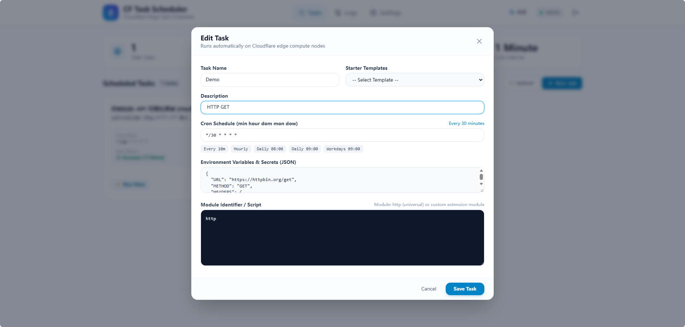
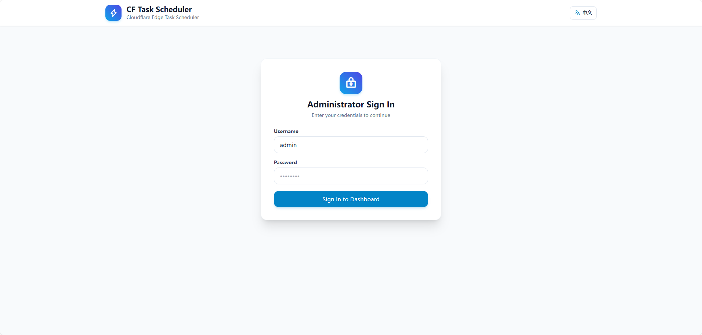

# ⚡ CF Task Scheduler

<p align="center">
  <strong>Serverless Cron Task Scheduler & Web Dashboard on Cloudflare Workers + D1</strong><br>
  基于 Cloudflare Workers + D1 边缘数据库构建的轻量级 Serverless 定时任务调度器与可视化管理系统
</p>

<p align="center">
  
  
  
  
  
</p>

<p align="center">
  <a href="#english">English</a> • <a href="#中文说明">简体中文</a>
</p>

---

### 📸 Preview / 界面预览

<p align="center">
  
</p>

<p align="center">
  
</p>

---

<a name="english"></a>
## 🌐 English

### Overview
**CF Task Scheduler** is an out-of-the-box, lightweight serverless task scheduling platform designed specifically for the Cloudflare ecosystem (like a serverless "Qinglong Panel" at the edge).

It requires **no dedicated servers**, **no VPS**, and **no complex Linux Crontab maintenance**. The entire platform runs globally on Cloudflare edge compute nodes with Cloudflare D1 (Serverless SQLite). It features a modern, responsive web dashboard for managing Cron schedules, task environment secrets, manual test executions, real-time log capturing, and multi-channel webhook alerts.

### ✨ Features
- **☁️ Zero Infrastructure Cost**: Runs entirely within Cloudflare Workers free tier (100,000 requests/day) and D1 database.
- **🔒 Irreversible PBKDF2 Password Security**:
  - Web Crypto standard **PBKDF2-SHA256** one-way hash algorithm.
  - Per-user **16-byte random salt** with **100,000 iterations**.
  - Mathematically irreversible, immune to rainbow tables and credential stuffing.
  - Constant-time verification (`crypto.subtle.timingSafeEqual`) to prevent timing side-channel attacks.
- **⏰ Flexible Cron Engine**:
  - Full support for 5-part Cron syntax (`0 8 * * *`, `*/15 * * * *`, `0 9 * * 1-5`, etc.).
  - Built-in friendly Cron presets and human-readable schedule explanations.
- **🌐 Universal HTTP / Webhook Runner**:
  - Configure target URL, HTTP method (GET/POST/PUT/DELETE), headers, and request body directly in the Web UI.
  - Driven purely by D1 database records without editing code.
- **📜 Millisecond-Level Logging**:
  - Automatically captures all execution output, start/end timestamps, and elapsed time.
  - Interactive terminal modal in Web UI with one-click copy and auto-retention cleanup (30 days).
- **🔔 Multi-Channel Notification Support**:
  - Built-in helpers for WeCom Bot, Feishu / Lark Bot, Telegram Bot, and iOS Bark push notifications.
- **🧩 Modular Architecture**:
  - Easily extend new task modules via `src/modules/` (see `CONTRIBUTING.md`).

### 🚀 Quick Start (Local Development)

```bash
# 1. Clone repository
git clone https://github.com/Mia0a-hi/cf-task-scheduler.git
cd cf-task-scheduler

# 2. Install dependencies
npm install

# 3. Run unit tests
npm test

# 4. Start local development server
npm run dev
```

Open `http://localhost:8787` in your browser. On first visit, the system will prompt you to set your master administrator credentials.

### 🌐 Deploy to Cloudflare Workers

1. **Log in to Cloudflare**:
   ```bash
   npx wrangler login
   ```
2. **Create D1 Database**:
   ```bash
   npx wrangler d1 create task_db
   ```
   Copy the generated `database_id` and replace the placeholder in `wrangler.toml`:
   ```toml
   [[d1_databases]]
   binding = "DB"
   database_name = "task_db"
   database_id = "your-actual-database-id"
   ```
3. **Deploy to Edge**:
   ```bash
   npm run deploy
   ```
   Access your deployed URL: `https://cf-task-scheduler.<your-subdomain>.workers.dev`.

---

<a name="中文说明"></a>
## 🇨🇳 中文说明

### 项目简介
**CF Task Scheduler** 是一套专为 **Cloudflare 边缘生态** 设计的轻量级开箱即用定时任务平台（类似于运行在 Cloudflare Workers 上的轻量化「青龙面板」）。

无需自备云服务器、无需配置 Linux Crontab，全部运行在 Cloudflare 全球边缘计算节点上。自带现代化响应式 Web 控制台，支持灵活的 Cron 定时表达式、任务环境变量管理、手动测试运行、毫秒级日志捕获与多渠道消息报警。

### ✨ 核心特性
- **☁️ 零服务器成本**: 完全运行在 Cloudflare Workers 免费层（100,000 请求/天）与 D1 数据库，全球边缘节点就近调度。
- **🔒 工业级密码安全 (不可逆加盐哈希)**:
  - 采用 **Web Crypto 标准 PBKDF2-SHA256** 单向算法；
  - 独立生成 **16 字节高熵随机盐 (Salt)**，迭代计算 **100,000 轮**；
  - **绝不可逆、不可解密**，杜绝彩虹表撞库；
  - 采用防时序攻击机制（`crypto.subtle.timingSafeEqual`）。
- **⏰ 灵活的 Cron 调度**:
  - 支持标准 5 位 Cron 语法（`0 8 * * *` 每日 8 点、`*/15 * * * *` 每 15 分钟、`0 9 * * 1-5` 工作日等）；
  - 内置中文人性化 Cron 规则解析与一键预设。
- **🌐 通用数据驱动 HTTP 引擎**:
  - 在 Web 页面直接配置 URL、请求方式（GET/POST/PUT/DELETE）、请求头与请求体，纯 D1 数据库存储，零代码即可管理各类接口打卡与数据抓取。
- **📜 毫秒级日志捕获与终端视图**:
  - 自动拦截任务运行中的所有日志输出并记录耗时；
  - 网页端终端弹窗高亮展示，支持一键复制，自动清理超过 30 天的历史日志。
- **🔔 多通道消息推送集成**:
  - 内置支持企业微信机器人、飞书机器人、Telegram Bot、iOS Bark 移动端推送。
- **🧩 模块化可扩展架构**:
  - 脚本与逻辑模块分离，便于轻松添加专属业务打卡/监控模块（参见 `CONTRIBUTING.md`）。

### 🚀 快速开始与本地调试

```bash
# 1. 克隆仓库
git clone https://github.com/Mia0a-hi/cf-task-scheduler.git
cd cf-task-scheduler

# 2. 安装依赖
npm install

# 3. 运行测试套件
npm test

# 4. 本地启动开发服务器
npm run dev
```

在浏览器打开 `http://localhost:8787`，首次进入系统会引导你初始化管理员用户名与强密码。

### 🌐 部署到 Cloudflare Workers

1. **在终端登录 Cloudflare**:
   ```bash
   npx wrangler login
   ```
2. **创建 Cloudflare D1 边缘数据库**:
   ```bash
   npx wrangler d1 create task_db
   ```
   将终端输出中的 `database_id` 填入 `wrangler.toml`：
   ```toml
   [[d1_databases]]
   binding = "DB"
   database_name = "task_db"
   database_id = "你的数据库UUID"
   ```
3. **一键推送到云端边缘节点**:
   ```bash
   npm run deploy
   ```
   部署完成后即可打开分配的专属链接在线使用。

---

## 📁 目录结构 / Project Structure

```text
cf-task-scheduler/
├── .gitignore             # Git 忽略配置
├── LICENSE                # MIT 开源许可证
├── package.json           # 项目配置与 NPM 脚本
├── README.md              # 双语主文档 (Bilingual README)
├── CONTRIBUTING.md        # 模块贡献指南 (Contribution Guide)
├── wrangler.toml          # Cloudflare Worker 配置文件
├── wrangler.toml.example  # 配置文件示例
├── schema.sql             # Cloudflare D1 数据库表结构
├── test/
│   └── verify.test.js     # 自动化安全与调度单元测试
└── src/
    ├── index.js           # Worker 调度与 REST API 路由入口
    ├── auth.js            # PBKDF2 强密码哈希与 JWT 鉴权
    ├── cron.js            # 时区友好的纯 JS Cron 调度解析器
    ├── db.js              # Cloudflare D1 边缘数据库操作层
    ├── runner.js          # 隔离执行器与全局日志捕获
    ├── templates.js       # 通用任务起手模板库
    ├── ui.js              # 响应式 Web 控制台（Tailwind + Vue 3）
    └── modules/
        ├── index.js       # 模块注册器
        └── http.js        # 通用 HTTP/Webhook 调度引擎
```

---

## 📄 License
[MIT License](LICENSE) © 2024-2026 CF Task Scheduler Contributors
